<p align="center">
  
</p>

<p align="center"><strong>Your daily task websites and userscripts, one flow.</strong></p>

<p align="center">
  <a href="https://github.com/BidyutRoy2/hiddengem-flow"></a>
  
  
  
</p>

<p align="center">
  A Chrome extension (Manifest V3) that keeps your daily websites and your userscripts in one place — a draggable floating window on any site, a full dashboard, and an official Script Store you publish to from a private page.
  No account. No tracking. Nothing runs until you say so.
</p>

---

## Download — ready to install

**[⬇ Download the extension (pre-release v1.0.0-dev-20261115)](https://github.com/BidyutRoy2/hiddengem-flow/releases/tag/v1.0.0-dev-20261115)** — get `hiddengem-flow-extension.zip`, extract it, then:

1. Open `chrome://extensions` (or `brave://extensions`) → turn on **Developer mode**.
2. Click **Load unpacked** and select the extracted folder.

That's it — the floating window and dashboard are ready. Two grants are still needed before any userscript runs (see [Install](#install-load-unpacked)): turn **Allow User Scripts** ON in the extension's Details page, then **Grant site access** for each script's site. This is a pre-final dev build; the final release will also be v1.0.0, the first version.

### Watch: install in 60 seconds

[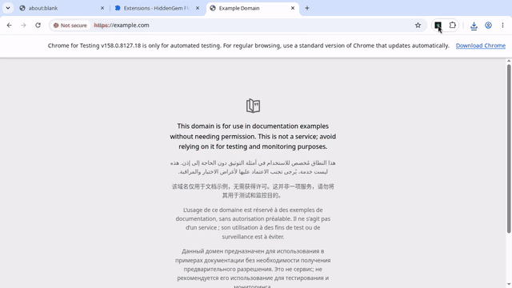](docs/install-guide/install.mp4)

**▶ [Watch the full install video (60 seconds)](docs/install-guide/install.mp4)** — recorded in real Chrome: download → extract → Load unpacked → Allow User Scripts → floating window opens. Recorded in Chrome for Testing; the steps are identical in normal Chrome. Full notes in [`docs/install-guide/RUN_NOTES.md`](docs/install-guide/RUN_NOTES.md).

GitHub READMEs can't embed an mp4 player, so the preview above plays as a GIF — click it for the full video, which plays on its file page.

**1. Download the zip from the release**

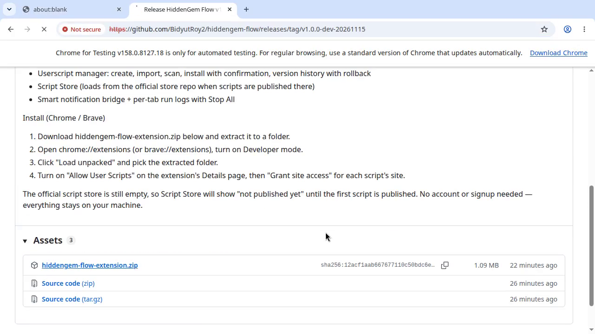

**2. Extract it — the folder contains `manifest.json`**

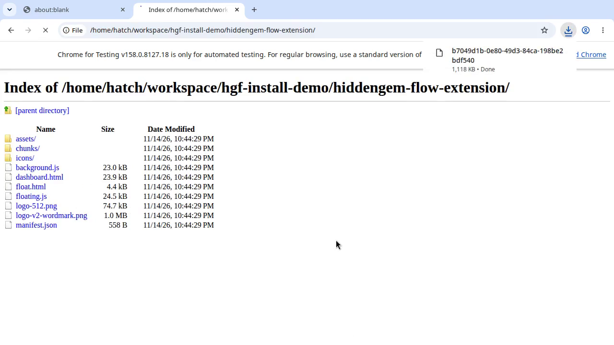

**3. Open `chrome://extensions` and turn Developer mode ON**

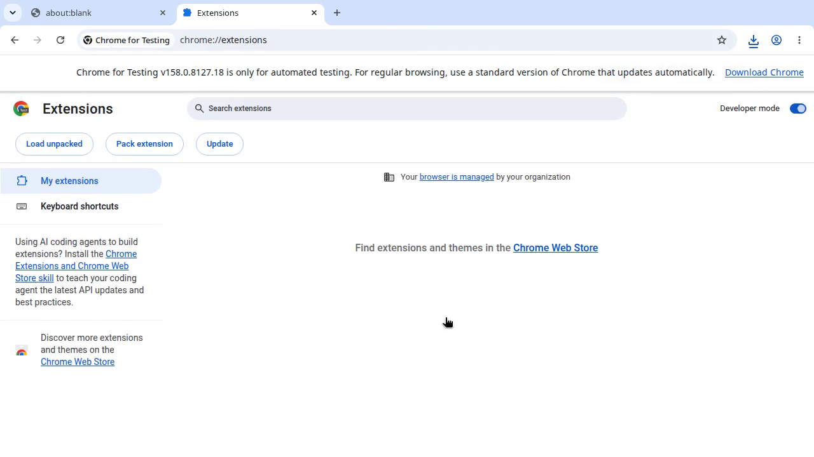

**4. Click Load unpacked and pick the extracted folder**

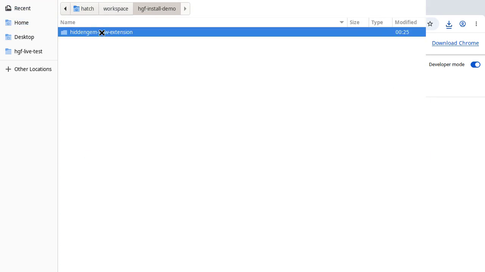

**5. HiddenGem Flow appears in the extensions list**

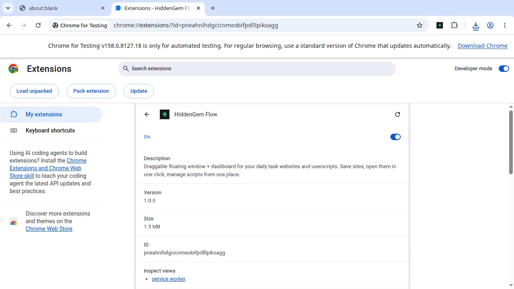

**6. Open Details and turn Allow User Scripts ON**

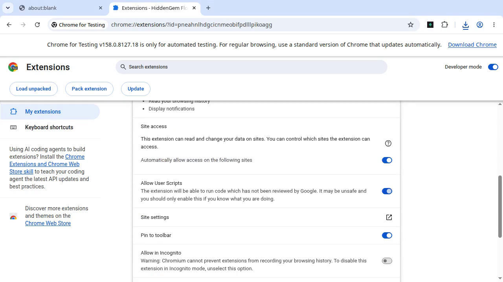

**7. Click the toolbar icon on any site — the floating window opens**

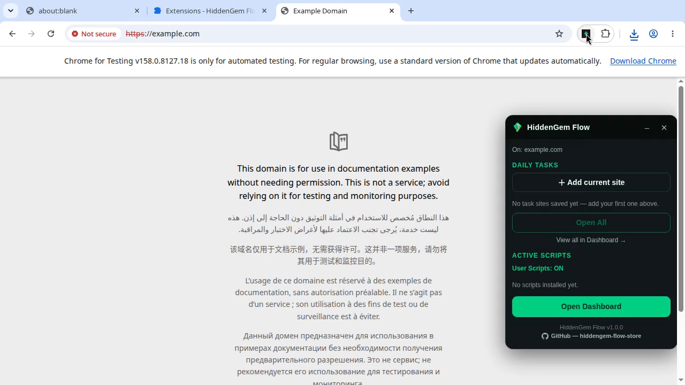

## Screenshots

| Dashboard | Floating window |
| :---: | :---: |
| 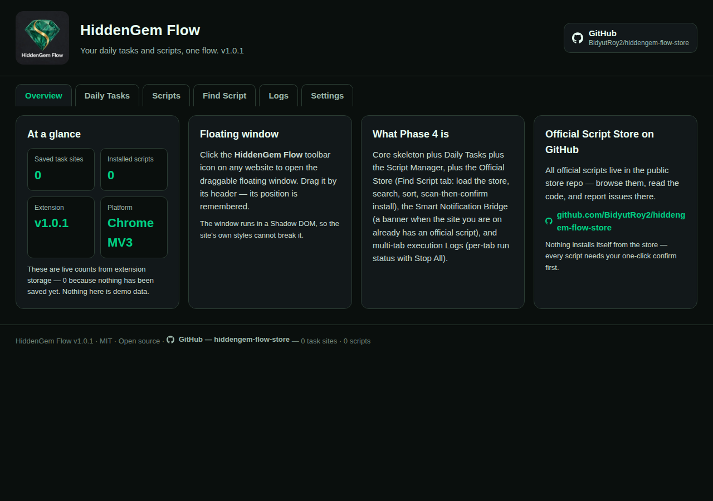 | 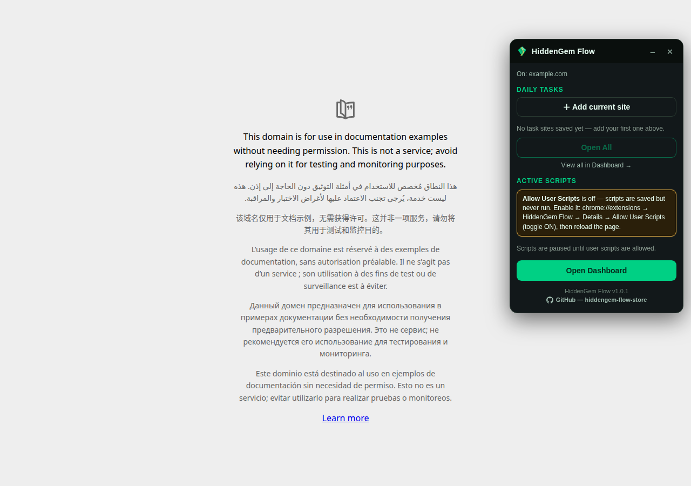 |
| **Script Store** | **Standalone popup — new tab, no website open** |
| 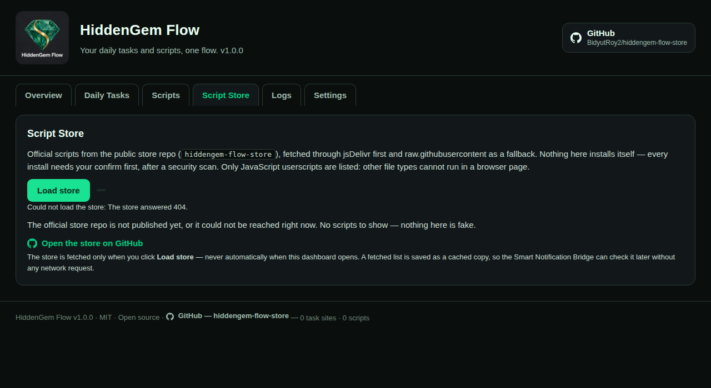 | 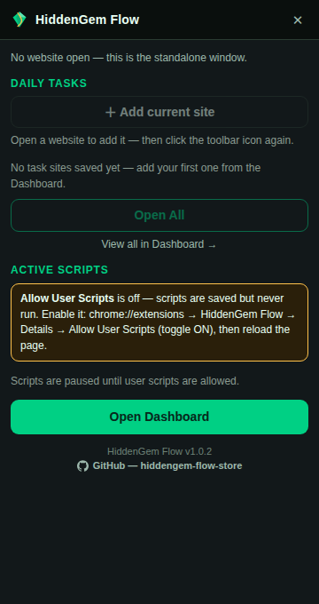 |

Screenshots are from the live test in real Chrome — see [`docs/LIVE_TEST_AUDIT.md`](docs/LIVE_TEST_AUDIT.md). The Script Store shot shows the honest empty state: the public store is empty until the first script is published there.

## What it does

- **Draggable floating window** — click the toolbar icon on any website and a small window opens. Drag it by the header, minimize it, close it; its position is remembered. It lives in a Shadow DOM, so the site's styles can't break it.
- **Works with no website open** — on a new tab, `chrome://` or `about:blank` the same floating UI opens as a small standalone popup window (360×680). Clicking again focuses it instead of opening a duplicate.
- **Daily Tasks** — save sites by name + URL, open one, several, or **Open All**. Tabs open one by one (~350 ms apart, max 50 at a time) and the result is reported honestly — *"Opened 3 tabs."* — never silently dropped. Only the first tab opens in the foreground; the rest open in the background. Pin, edit, delete, search. Duplicate URLs are rejected. **Export tasks (.json)** downloads all of them to one JSON file (`hiddengem-flow-tasks-YYYY-MM-DD.json`, pinned first, then newest); **Import tasks (.json)** reads such a file back and merges it — a URL already saved is skipped, nothing is ever deleted, and one line reports the counts ("Imported 5 tasks. 1 skipped — already saved."). A file that is not a tasks backup is refused with a clear error and nothing changes.
- **Script Manager** — create, import, run, back up, delete and upgrade userscripts. Every install is scanned first (score 0–100, grade A–F) and needs your explicit **Confirm** — the scan warns, it never blocks. Version history keeps the last 10 versions with a Rollback button. Import from `.js`, `.user.js`, `.txt` or any text file, pasted code, or a URL you fetch yourself. Export any script as `.user.js` or `.txt`.
- **Script Store** — the official store lives in the public repo [`BidyutRoy2/hiddengem-flow-store`](https://github.com/BidyutRoy2/hiddengem-flow-store) and is fetched through raw.githubusercontent first, jsDelivr as a fallback. Search, sort by Recently updated / Latest / Name, and install any script only after a scan + your confirm. Nothing installs itself, nothing is fetched until you click **Load store**.
- **Smart Notification Bridge** — if the site you're on already has an official script, a dismissible banner says so and offers it in one click from the Script Store.
- **Multi-tab Logs** — every tab the extension opens gets a run entry (Queued → Running → Done) with the scripts that match it, and **Stop All** closes only the tabs this extension opened.

## Publish scripts with the private Store Uploader

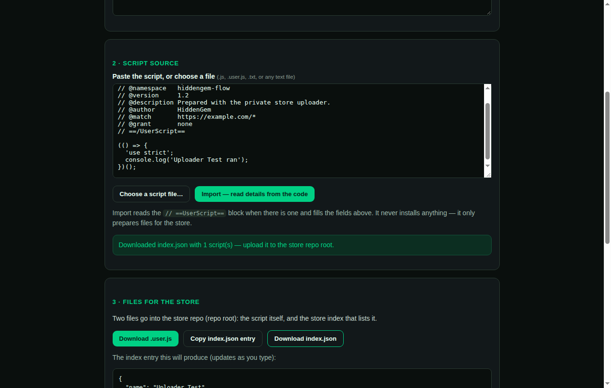

[`tools/store-uploader.html`](tools/store-uploader.html) is a single standalone page — open it from your computer, no server. Create a fine-grained Personal Access Token on GitHub (Contents read/write on `hiddengem-flow-store` only — the exact steps are on the page), paste it, and **Test connection** verifies it before anything is published. The token lives only in that page's localStorage, with a **Forget token** button, and is never written into the file.

- **New Script** — fill in Name / Version / Description / Author / @match, paste code or choose a file, click **Import**, then **Publish to the store**. It uploads the script to `scripts/`, updates `index.json`, and clears the jsDelivr cache for both files.
- **Live Scripts** — lists every published script (total count + search) and upgrades any of them; the version field suggests a bump (1.0.0 → 1.0.1) and **Publish upgrade** uploads the new file and updates the index entry. Each card also has a **Delete** button (two clicks: arm, then confirm) — it removes the entry from `index.json` first, then deletes the file from `scripts/`, and purges both from jsDelivr; deleting needs a token, and it only stops the store listing the script (anyone who already installed it keeps their local copy).
- No token? **Download .user.js** / **Download index.json** / **Copy index.json entry** still work — upload the two files on github.com by hand.

After a publish, open the Script Store tab and click **Load store** — the new script is listed.

## Install (Load Unpacked)

```bash
npm install
npm run build      # output in .output/chrome-mv3/
```

1. Open `chrome://extensions` → turn on **Developer mode** (top right).
2. Click **Load unpacked** and select the `.output/chrome-mv3/` folder.
3. Go to any `https://` site and click the **HiddenGem Flow** toolbar icon — the floating window appears.

Two grants are needed before any userscript runs. Both are yours to give — no extension can do them for you:

1. **Allow User Scripts** — `chrome://extensions` → HiddenGem Flow → Details → turn **Allow User Scripts** ON. The dashboard and the floating window both show a button that opens that Details page directly.
2. **Site access** — click **Grant site access** on a script and allow Chrome's prompt. Until granted, a script is registered but never runs.

## Updates (unpacked installs never auto-update)

Chrome never updates an unpacked extension by itself — there is no self-update API and no extension can replace its own files. So HiddenGem Flow **notices** a newer build instead of installing one: it checks the public GitHub releases page at most once every 6 hours (on startup and when the dashboard opens), plus whenever you click **Check for updates** in Settings. When a newer build exists, the **Overview tab shows a banner** with the release tag and the manual steps — download the new build from the release page, replace the files in your unpacked extension folder, then press **Reload** in `chrome://extensions`. **Do not remove the extension** — removing deletes your saved tasks and scripts. The floating window shows one compact line ("Update available: <tag> — open the Dashboard to download it."); the banner can be dismissed per release (a newer build shows it again). No desktop notification, no data sent — the check is a plain, unauthenticated listing request to `api.github.com` for the public releases. Real auto-update will come with the Chrome Web Store release (not yet published). One honest quirk: the check compares the build's date against the release asset's upload time, so a fresh install of a just-uploaded build may briefly report an update available pointing at itself — Dismiss hides it until the next build.

## Privacy

- Everything you save — tasks, scripts, positions, logs — stays in `chrome.storage.local` on your machine.
- Two automatic external requests exist: a best-effort favicon image (Google's s2 service) next to each task site (if it fails, a letter tile shows instead), and the update checker asking `api.github.com` for the latest public release at most once every 6 hours, plus on manual check (see Updates above).
- The store is fetched only when you click **Load store**. Importing from a URL fetches only that URL, when you click it.
- No account, no analytics, no telemetry.

## Permissions

| Permission | Why |
|---|---|
| `storage` | Save tasks, scripts, window position, logs. |
| `tabs` | Open the dashboard and task sites; read the active tab for "Add current site". |
| `scripting` | Inject the floating window into the tab on click. |
| `activeTab` | Temporary access to the tab you clicked — this is what lets the extension ask for **no host permissions at all**. |
| `userScripts` | Register / unregister userscripts. Chrome additionally needs the **Allow User Scripts** toggle (see Install). |
| `notifications` | Only for `GM_notification` from a running userscript. |

There is no `default_popup`, and no required host permission. Site access for userscripts is an *optional* permission (`*://*/*`), granted per site only when you ask a script to run.

## Honest limits

- **Only JavaScript userscripts run in a browser page.** A file in another language can be opened and inspected, but it cannot run — the import says so plainly.
- **Only four GM functions exist:** `GM_setValue`, `GM_getValue`, `GM_notification`, `GM_addStyle` (plus the `GM.*` object form). `GM_xmlhttpRequest`, `GM_openInTab`, `GM_download`, `GM_setClipboard`, `unsafeWindow` and the rest are **not** implemented — a script that calls one gets a scanner warning and a runtime error, never a fake.
- `GM_setValue` / `GM_getValue` values live in the page origin's `localStorage`, namespaced per script — visible to the page's own JavaScript. Never store secrets with `GM_*`.
- The scanner is a regex heuristic: it strips comments and strings first, so it can miss obfuscated code and can flag a pattern used safely. It is a warning, never proof of safety.
- The floating window cannot be *injected* on `chrome://`, Web Store, or other restricted pages — Chrome forbids it. Since v1.0.2 the click there opens the standalone popup instead.
- A script with no `@match` patterns is saved but never registered.
- The store is empty until the first script is published — **Load store** says so honestly until then.

## Develop

```bash
npm install
npm run dev        # WXT dev mode (Chrome)
npm run typecheck
npm run build      # output in .output/chrome-mv3/
```

Requires Node 22+. See [`docs/AUDIT.md`](docs/AUDIT.md) for the deep audit and [`docs/LIVE_TEST_AUDIT.md`](docs/LIVE_TEST_AUDIT.md) for the live click-test results in real Chrome.

## Project layout

```
entrypoints/
  background.ts            # toolbar click, floating toggle, open-urls, script bridge, run log, popup routing
  floating.ts              # in-page floating window (Shadow DOM, drag, tasks, scripts, bridge banner)
  float/                   # standalone floating page for new-tab pages
  shared/                  # tasks, scripts, engine (userScripts + GM shim), store, runs
  dashboard/               # Overview, Daily Tasks, Scripts, Script Store, Logs, Settings
tools/
  store-uploader.html      # private script publisher (single file, no server)
public/                    # icons + wordmark used by the built extension
assets/                    # source artwork
docs/                      # audit, live-test audit, live-test screenshots
```

## Status

**v1.0.0 — pre-final dev build.** All phases are built, deep-audited and live click-tested in real Chrome (see `docs/LIVE_TEST_AUDIT.md`). The final release will also be v1.0.0, the first version — there are no version bumps until then. Firefox comes later, after Chrome is proven.

## License

MIT — see [LICENSE](LICENSE).
